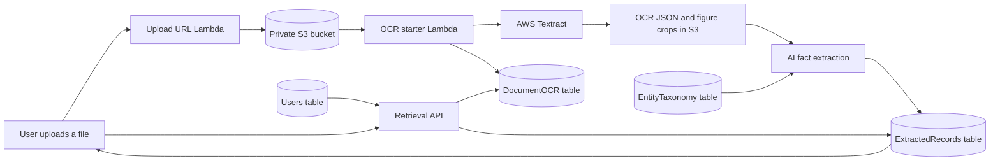
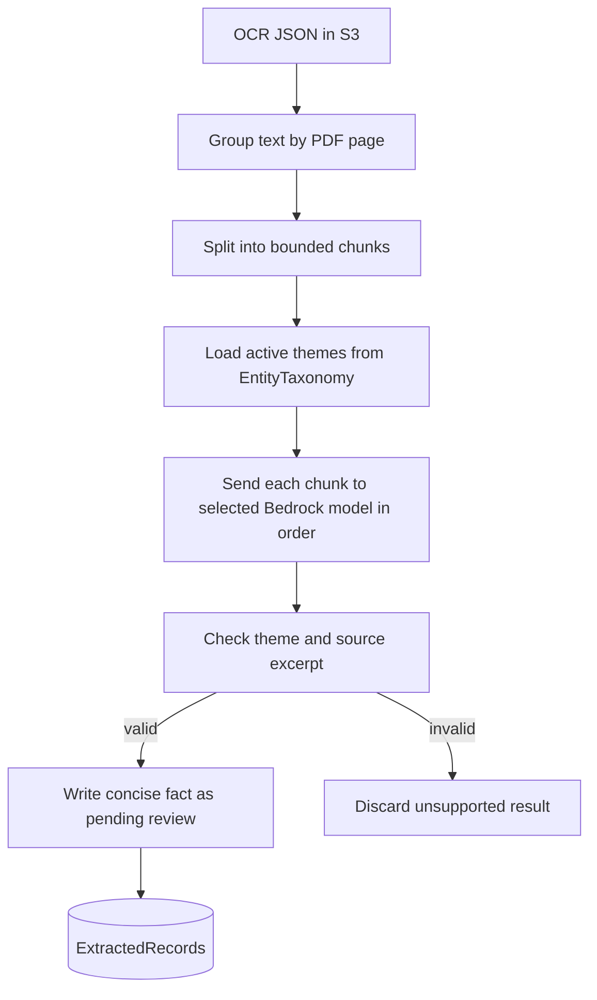

# BREATHE System Guide

This guide explains the document archive in plain language. It describes the current
data flow and the planned Atlas view; Atlas geocoding and map search are not built yet.

## 1. What happens to a document



1. The browser asks for a temporary S3 upload URL and uploads the file directly to
   private S3.
2. An S3 upload event starts OCR. Textract reads the pages; the backend saves OCR JSON
   and figure crops under `processed/{document_id}/`.
3. DynamoDB keeps the document's status and metadata. The large OCR result stays in S3.
4. After OCR, AI extraction can read the OCR JSON and create reviewable facts.
5. The browser loads documents and facts through the retrieval API. It uses temporary
   presigned links to show the original PDF and OCR result.

## 2. Main tables

| Table | Primary key | What it stores |
|---|---|---|
| `jrf-task-ocr-DocumentOCR` | `document_id` | Document name/tag, upload and OCR status, S3 bucket and keys, page counts, and AI review counts. |
| `jrf-task-ocr-ExtractedRecords` | `id` + `theme_entity_id` | Extracted or user-entered facts for one document. The partition value is `DOC#{document_id}`. |
| `jrf-task-data-EntityTaxonomy` | `entity_key` | Active themes and instructions used by AI prompts. |
| `jrf-task-BreatheUsers` | `username` | User role, password hash, email, and allowed app tabs. |

Important fields:

- **DocumentOCR:** `filename`, `doc_name`, `doc_tag`, `status`, `s3_bucket`, `s3_key`,
  `ocr_s3_key`, `total_pages`, `uploaded_at`, `ingestion_status`,
  `extracted_entity_count`, and `pending_review_count`.
- **EntityTaxonomy:** `entity_key`, `display_name`, `description`, `keywords`,
  `extraction_guidance`, `is_active`, and `updated_at`.
- **Users:** `username`, `password_hash`, `role`, `email`, `permissions`, and
  `created_at`. Password hashes are backend data; never expose them in the UI.
- **OCR JSON in S3:** document metadata plus `elements` (page, text, confidence,
  normalized bounding box), `layout`, `tables`, and `figures`.

`ExtractedRecords` also has `ThemeIndex` (`theme`, `document_id`) and `LocationIndex`
(`district`, `document_id`). A typical record contains:

```json
{
  "id": "DOC#document-uuid",
  "theme_entity_id": "CLIMATE_METRICS#P02_C001_F01",
  "document_id": "document-uuid",
  "theme": "CLIMATE_METRICS",
  "entity_type": "thematic_fact",
  "extracted_fact": "A concise statement supported by the document.",
  "source_excerpt": "The wording from the OCR text that supports the fact.",
  "pdf_page_num": 2,
  "spatial_units": {"district": "Bidar"},
  "temporal_period": "1934",
  "confidence_score": 0.9,
  "review_status": "pending_review"
}
```

AI facts use `thematic_fact`. User-saved OCR items use `user_saved`; manually added
facts use `manual_fact`. The Database source filter groups the latter two as
**User saved**.

## 3. How AI extraction works



- Only active themes from `jrf-task-data-EntityTaxonomy` are prompt choices.
- OCR text is grouped by page and split into bounded chunks; the current default chunk
  size is 6,000 characters, with pages grouped in batches of up to 10.
- Chunks are sent to the selected model sequentially, not all at once.
- Each fact includes its taxonomy theme, concise description, source excerpt, page,
  location/time fields when present, and confidence.
- Backend validation rejects unknown themes and source excerpts not supported by the
  chunk. Facts start with `review_status=pending_review`.
- Models are allow-listed: Nova Lite, Nova 2 Lite, and Ministral in Sydney; Llama 3.1
  8B in `us-west-2`. Access depends on AWS account and region permissions.

The upload/OCR worker is `lambda_starter.py`. AI extraction logic is in
`ai_extractor.py`, with DynamoDB-writing flows in `dynamo_ingestion.py` and
`lambda_function.py`. `lambda_retrieval.py` also contains the existing extraction API
route. The deployed API Gateway integration must match the chosen handler and package.

## 4. App actions and API

| App action | Data operation |
|---|---|
| Upload file | Create presigned URL, S3 PUT, OCR status updates. |
| Browse history | List DocumentOCR metadata with document tags. |
| Save document name/tag | Update `doc_name` and `doc_tag` on DocumentOCR. |
| Start AI extraction | Read OCR JSON and taxonomy; write pending facts. |
| Review or edit fact | Read/update a row in ExtractedRecords. |
| Approve selected/all | Set review state and approved timestamp. |
| Remove fact | Delete its ExtractedRecords row. |
| Delete document | Admin-only; remove document S3 files, its fact rows, then metadata. |

Important paths include `GET /documents`, `GET` and `DELETE /document/{id}`,
`PUT /document/{id}/meta`, `POST /api/documents/ingest-dynamo`,
`/api/documents/{id}/records`, and `/api/database/taxonomy`. The production API Gateway
DELETE route is connected to the retrieval Lambda. In a new environment, create the
route and invoke permission separately; handler code does not create an API Gateway
route automatically.

## 5. Permissions and safety

Login is handled by `lambda_auth.py`; it issues signed, expiring JWTs. Admins can grant
tab permissions in the Users view. Tab gating is a frontend behavior and is not server
authorization. Existing list, retrieval, and record routes retain their prior access
behavior.

Document deletion has a backend admin check: it validates the JWT signature and expiry,
then checks the current user role in `jrf-task-BreatheUsers`. The retrieval Lambda needs
the same protected `JWT_SECRET` and the configured users-table name. It refuses to
delete during OCR or AI processing. S3 errors are returned rather than reported as a
successful delete.

## 6. Atlas: planned next step

The Atlas tab is a placeholder for a future map. The intended work is:

1. Review and normalize location names from extracted facts.
2. Resolve names to latitude/longitude with a geocoding service and store the result,
   source, and confidence. Keep the original text so researchers can audit the match.
3. Send uncertain or duplicate place matches to an admin/reviewer instead of silently
   choosing a coordinate.
4. Show confirmed places on a map. Selecting a place should show approved facts, their
   document-specific page numbers, and links to the source documents.
5. Add location search and filters for theme, period, document tag, and review status.

The map, geocoding provider, coordinate schema, and map permissions need a separate
implementation decision before building this feature.

## 7. Optional Document AI Chat

The **Chat with AI** tab can open a separately hosted or local Q&A app. The local
`jrf-task-llm` project reads completed OCR through the OCR API, chunks text by page,
stores chunks and chat history as local JSON, and uses BM25 keyword search with local
GGUF models. It does not write into the OCR DynamoDB tables. An AWS Bedrock/DynamoDB
design also exists as a separate plan; do not treat it as the currently deployed
storage path.

## 8. Where to look next

- [Frontend notes](./NLP-Pipleline-frontEnd/NLP-Pipeline-Work-README.md)
- [Backend routes and deployment](./textract-backend/NLP-Pipeline-Backend-README.md)
- [Authentication and permissions](./textract-backend/AUTH-DEPLOYMENT-README.md)
